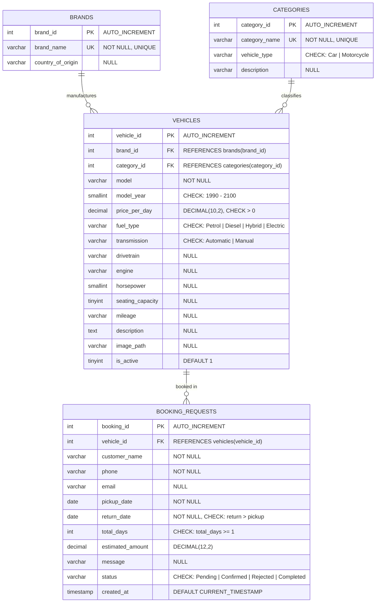

# 🏎️ Luxury Vehicle Catalog & Booking System

[](https://nodejs.org/)
[](https://expressjs.com/)
[](https://www.mysql.com/)
[](https://developer.mozilla.org/en-US/docs/Web/JavaScript)
[](#)

A database-backed web catalog of curated luxury cars and iconic motorcycles inspired by the browse, filter, sort, and vehicle-specification experience of **GTA Base's vehicle database**. It features multi-criteria search, attribute filtering, dynamic sorting, detailed technical specifications, and a server-validated booking request lifecycle with a local manager review dashboard.

> **Academic Scope Note:** This project is an academic 50–60% MVP built for a college DBMS mini project demonstration. It emphasizes relational schema design, referential integrity, check constraints, parameterized query execution, aggregate reporting, and an explainable client-server booking request lifecycle.

---

## 📌 Table of Contents
- [1. Key Features](#1-key-features)
- [2. Technology Stack](#2-technology-stack)
- [3. System Architecture & Database Design](#3-system-architecture--database-design)
  - [Entity-Relationship (ER) Diagram](#entity-relationship-er-diagram)
  - [Relational Schema & Constraints](#relational-schema--constraints)
  - [Demonstration Viva SQL Queries](#demonstration-viva-sql-queries)
- [4. Project Structure](#4-project-structure)
- [5. Getting Started](#5-getting-started)
  - [Prerequisites](#prerequisites)
  - [Installation & Setup](#installation--setup)
- [6. API Documentation](#6-api-documentation)
- [7. Business Rules & Logic](#7-business-rules--logic)
- [8. Manager Dashboard](#8-manager-dashboard)
- [9. Data Notes & Academic Caveats](#9-data-notes--academic-caveats)
- [10. Known Limitations](#10-known-limitations)

---

## 1. Key Features

- **Dynamic Fleet Catalog:**
  - Real-time debounced search by brand name, vehicle model, or category.
  - Multi-criteria filtering by vehicle type (`Car` vs. `Motorcycle`), category (Supercar, Sports Car, Luxury Coupe, Superbike, Cruiser, Cafe Racer), fuel type (`Petrol`, `Diesel`, `Hybrid`, `Electric`), transmission (`Automatic`, `Manual`), and interactive price range slider.
  - Multi-field sorting by daily rental price (ascending / descending), model year (newest first), and alphabetical model name.
- **Detailed Vehicle Specifications:**
  - Dedicated vehicle details view (`/vehicle-details.html?id=:id`) displaying engine displacement, horsepower, drivetrain, seating capacity, mileage, fuel type, transmission, and daily rental rates.
- **Server-Authoritative Booking Workflow:**
  - Interactive booking request form with live date difference and estimated amount preview.
  - Server-authoritative price calculation: `stored price_per_day × rental_days`. Tampering with rates in request payloads is strictly ignored and recalculated server-side.
  - Input validation enforcing checkout date convention (`return_date > pickup_date`) and minimum 1-day rental.
  - Generates auto-incremented reference `booking_id` with initial `Pending` status.
- **Local Manager Review Dashboard:**
  - Local operational dashboard (`/manager.html`) to review submitted inquiries with real-time status counts.
  - Interactive status transitions: `Pending` ➔ `Confirmed`, `Rejected`, or `Completed`.
- **DBMS Viva Demonstration Suite:**
  - Pre-built SQL queries illustrating DDL, DML, multi-table JOINs, aggregates (`COUNT`, `AVG`, `SUM`), `GROUP BY`, subqueries, check constraint triggers, and `EXPLAIN` query execution plans.

---

## 2. Technology Stack

| Layer | Technologies | Description |
| :--- | :--- | :--- |
| **Frontend** | HTML5, CSS3, Vanilla JavaScript (ES6+) | Semantic HTML, CSS design tokens (Midnight Black `#111318`, Champagne Gold `#C8A96B`, Warm Ivory `#F5F3EE`), responsive grid, dynamic fetch API without heavy frontend frameworks. |
| **Backend** | Node.js, Express.js (v4.19.2) | Lightweight RESTful API server with modular route handlers and static asset serving. |
| **Database** | MySQL (8.0+) / MariaDB (10.5+) | Relational database with strict foreign keys, check constraints, indexes, and normalized tables. |
| **Driver** | `mysql2` (promise-based) | High-performance MySQL client utilizing connection pooling and parameterized SQL queries to prevent SQL injection. |
| **Configuration**| `dotenv` | Environment variable management for database credentials and port bindings. |

---

## 3. System Architecture & Database Design

### Entity-Relationship (ER) Diagram



### Relational Schema & Constraints

The relational schema is defined in [`database/schema.sql`](database/schema.sql):

1. **`brands`**: Normalizes vehicle manufacturers (`brand_id`, `brand_name`, `country_of_origin`).
   - Cardinality: $1 : N$ with `vehicles`.
2. **`categories`**: Classifies vehicles into distinct types (`category_id`, `category_name`, `vehicle_type`, `description`).
   - Constraint: `CHECK (vehicle_type IN ('Car', 'Motorcycle'))`.
   - Cardinality: $1 : N$ with `vehicles`.
3. **`vehicles`**: Stores full fleet inventory, specifications, and daily rates.
   - Foreign Keys: `brand_id` $\rightarrow$ `brands(brand_id)`, `category_id` $\rightarrow$ `categories(category_id)`.
   - Integrity Constraints:
     - `CHECK (price_per_day > 0)`
     - `CHECK (model_year BETWEEN 1990 AND 2100)`
     - `CHECK (fuel_type IN ('Petrol', 'Diesel', 'Hybrid', 'Electric'))`
     - `CHECK (transmission IN ('Automatic', 'Manual'))`
     - `UNIQUE (brand_id, model, model_year)`
   - Performance Indexes: `idx_vehicles_brand`, `idx_vehicles_category`.
4. **`booking_requests`**: Stores customer inquiries and manager review statuses.
   - Foreign Key: `vehicle_id` $\rightarrow$ `vehicles(vehicle_id)`.
   - Integrity Constraints:
     - `CHECK (return_date > pickup_date)`
     - `CHECK (total_days >= 1)`
     - `CHECK (status IN ('Pending', 'Confirmed', 'Rejected', 'Completed'))`
   - Default Status: `'Pending'`.
   - Performance Indexes: `idx_bookings_status`, `idx_bookings_vehicle`.

### Demonstration Viva SQL Queries

The file [`database/queries.sql`](database/queries.sql) contains runnable queries designed for project presentation and viva evaluation:

- **Catalog Listing JOINs:** Multi-table `INNER JOIN` linking `vehicles`, `brands`, and `categories`.
- **Search & Multi-Filter Queries:** Parameterized `LIKE` and range queries filtering by fuel type, brand, and price bracket.
- **Aggregations & Summaries:** `COUNT(*)` fleet size, `ROUND(AVG(price_per_day), 2)` average pricing by category, and `SUM(estimated_amount)` total booking pipeline.
- **Subqueries:** Finding luxury vehicles priced higher than the fleet-wide average.
- **Integrity Demonstrations:** Deliberate constraint violations illustrating database engine enforcement (e.g., checkout before pickup date, non-existent foreign keys).
- **Query Optimization (`EXPLAIN`):** Execution plan inspections demonstrating index coverage.

---

## 4. Project Structure

```text
Luxury-vehicle-booking-system/
├── assets/                              # Original source vehicle image assets
│   ├── bikes/                           # High-resolution motorcycle photos
│   └── cars/                            # High-resolution luxury car photos
├── config/
│   └── database.js                      # mysql2 connection pool configuration
├── database/
│   ├── schema.sql                       # DDL: Database creation, tables, constraints, indexes
│   ├── seed.sql                         # DML: Seed brands, categories, vehicles, sample bookings
│   └── queries.sql                      # Demonstration & viva SQL queries
├── docs/
│   ├── AUDIT.md                         # Codebase audit & PRD compliance verification
│   └── er-diagram.md                    # Standalone Mermaid ER diagram specification
├── public/                              # Express static frontend assets
│   ├── about.html                       # Academic project overview & background
│   ├── booking.html                     # Booking inquiry form with dynamic date calculations
│   ├── contact.html                     # Demonstration contact page & hours
│   ├── index.html                       # Landing page with hero CTA and featured fleet
│   ├── manager.html                     # Local manager review dashboard
│   ├── vehicle-details.html             # Detailed vehicle specifications view
│   ├── vehicles.html                    # Fleet catalog with search, filter, and sorting
│   ├── css/
│   │   └── style.css                    # Responsive CSS design system & color palette
│   ├── js/
│   │   ├── booking.js                   # Client validation, date diff, POST request handler
│   │   ├── main.js                      # Shared UI components & formatting helpers
│   │   ├── manager.js                   # Dashboard request rendering & PATCH status updater
│   │   └── vehicles.js                  # Dynamic fetch, search, multi-filter, sort, clear
│   └── images/
│       └── vehicles/                    # Web-optimized vehicle images
├── routes/
│   ├── bookingRoutes.js                 # API routes: POST /api/bookings, GET, PATCH status
│   └── vehicleRoutes.js                 # API routes: GET /api/vehicles, /:id, /meta/filters
├── .env.example                         # Template for environment configuration
├── .gitignore                           # Excludes node_modules/ and local .env
├── Luxury_Vehicle_Catalog_Booking_PRD.docx # Formal Product Requirements Document
├── package.json                         # Node dependencies & project metadata
├── package-lock.json                    # Dependency lockfile
├── README.md                            # Comprehensive project documentation
└── server.js                            # Express application entry point
```

---

## 5. Getting Started

### Prerequisites

- **Node.js**: v18.0.0 or higher ([Download Node.js](https://nodejs.org/))
- **MySQL Server**: v8.0 or higher / MariaDB 10.5+ ([Download MySQL](https://dev.mysql.com/downloads/mysql/))
- **Git**: Installed and configured on your system

### Installation & Setup

1. **Clone the repository:**
   ```bash
   git clone https://github.com/arjun-sjadhav/Luxury-vehicle-booking-system.git
   cd Luxury-vehicle-booking-system
   ```

2. **Initialize the MySQL Database:**
   Ensure your MySQL service is running, then execute the schema and seed scripts:
   ```bash
   mysql -u root -p < database/schema.sql
   mysql -u root -p < database/seed.sql
   ```
   *(On Windows PowerShell, use the MySQL command prompt or run: `Get-Content database/schema.sql | mysql -u root -p`)*

3. **Configure Environment Variables:**
   Create your local `.env` file from `.env.example`:
   ```bash
   # Windows PowerShell
   Copy-Item .env.example .env

   # Linux / macOS
   cp .env.example .env
   ```

   Update the `.env` file with your local MySQL password:
   ```env
   DB_HOST=localhost
   DB_PORT=3306
   DB_USER=root
   DB_PASSWORD=your_mysql_password
   DB_NAME=luxury_vehicles
   PORT=3000
   MANAGER_LOCAL_ONLY=false
   ```

4. **Install Dependencies & Launch Server:**
   ```bash
   npm install
   npm start
   ```

5. **Access the Application:**
   - **Customer Portal / Fleet Catalog:** [`http://localhost:3000`](http://localhost:3000)
   - **Manager Dashboard:** [`http://localhost:3000/manager.html`](http://localhost:3000/manager.html)

---

## 6. API Documentation

### Endpoints Overview

| Method | Endpoint | Description |
| :--- | :--- | :--- |
| `GET` | `/api/vehicles` | Returns active fleet items. Accepts query parameters: `search`, `type`, `category`, `fuel`, `transmission`, `minPrice`, `maxPrice`, `sort`. |
| `GET` | `/api/vehicles/meta/filters` | Returns available filter categories and vehicle types for dynamic UI dropdowns. |
| `GET` | `/api/vehicles/:id` | Returns full specifications for a single active vehicle. |
| `POST` | `/api/bookings` | Validates customer input, recalculates duration and estimated cost server-side, and stores a new booking request in `Pending` state. |
| `GET` | `/api/bookings` | Retrieves all booking requests along with vehicle details and status breakdown counts (for Manager dashboard). |
| `PATCH`| `/api/bookings/:id/status` | Updates the status of an existing booking request (`Pending`, `Confirmed`, `Rejected`, `Completed`). |

### Sample API Requests

#### 1. Filter Fleet (Supercars sorted by Price Descending)
```bash
curl "http://localhost:3000/api/vehicles?type=Car&sort=price_desc"
```

#### 2. Fetch Single Vehicle Details
```bash
curl "http://localhost:3000/api/vehicles/1"
```

#### 3. Submit a Booking Request
```bash
curl -X POST http://localhost:3000/api/bookings \
  -H "Content-Type: application/json" \
  -d '{
    "vehicle_id": 1,
    "customer_name": "Demo Client",
    "phone": "+91 98765 43210",
    "email": "client@example.com",
    "pickup_date": "2026-11-15",
    "return_date": "2026-11-17",
    "message": "Academic demonstration request"
  }'
```

**Response (`201 Created`):**
```json
{
  "message": "Booking request submitted successfully",
  "booking_id": 5,
  "total_days": 2,
  "estimated_amount": 36000
}
```

#### 4. Update Request Status (Manager)
```bash
curl -X PATCH http://localhost:3000/api/bookings/5/status \
  -H "Content-Type: application/json" \
  -d '{"status": "Confirmed"}'
```

---

## 7. Business Rules & Logic

- **Rental Duration Convention:** The system strictly treats the return date as checkout date. For instance, pickup on **November 10** and return on **November 12** calculates to **2 rental days** (`(Return - Pickup) = 2`).
- **Server-Authoritative Pricing:** The estimated total amount is calculated exclusively on the server as:
  $$\text{Estimated Total} = \text{Database Price Per Day} \times \text{Rental Days}$$
  Client-submitted prices or totals are disregarded to prevent manipulation.
- **Request Lifecycle:** Newly submitted bookings always begin in `Pending` status. Review operators can transition them to `Confirmed`, `Rejected`, or `Completed`.
- **Concurrency & Inventory Scope:** In accordance with the academic MVP specification, live inventory locks and calendar collision preventions are deliberately omitted.

---

## 8. Manager Dashboard

- **Access URL:** [`http://localhost:3000/manager.html`](http://localhost:3000/manager.html)
- **Purpose:** Allows administrators or evaluators to view incoming inquiries, filter requests, observe aggregate metrics, and update review statuses.
- **Security Notice:**
  > ⚠️ **Demo Only — No Authentication:** This dashboard is designed solely for local development and academic evaluation. It contains no authentication or role-based access control and should not be deployed in a public production environment.

---

## 9. Data Notes & Academic Caveats

- **Demo Pricing:** Daily rental rates (in INR) are illustrative demonstration estimates.
- **Specifications:** Technical parameters (horsepower, engine, mileage) are sampled from real-world manufacturer specifications for educational demonstration.
- **Vehicle Imagery:** Car and motorcycle imagery is utilized strictly under fair-use educational demonstration purposes.

---

## 10. Known Limitations

As outlined in the formal Product Requirements Document (PRD §21):
1. **No User Authentication:** No visitor account creation, customer login, or password management.
2. **No Payment Gateway:** No real credit card processing, payment gateway integration (Razorpay/Stripe), or automated tax invoices.
3. **No External Notification Service:** No automated SMS (Twilio) or transactional email (SendGrid) triggers on submission.
4. **No Calendar Collision Locking:** Overlapping booking inquiries for the same vehicle can be submitted for review.

---

## 📄 License & Attribution

- Built as an **Academic DBMS Mini Project**.
- Original concept and UI layout inspired by [GTA Base](https://www.gtabase.com/grand-theft-auto-v/vehicles/). All styling, schema, API implementations, and codebase logic are custom-built for educational demonstration.
