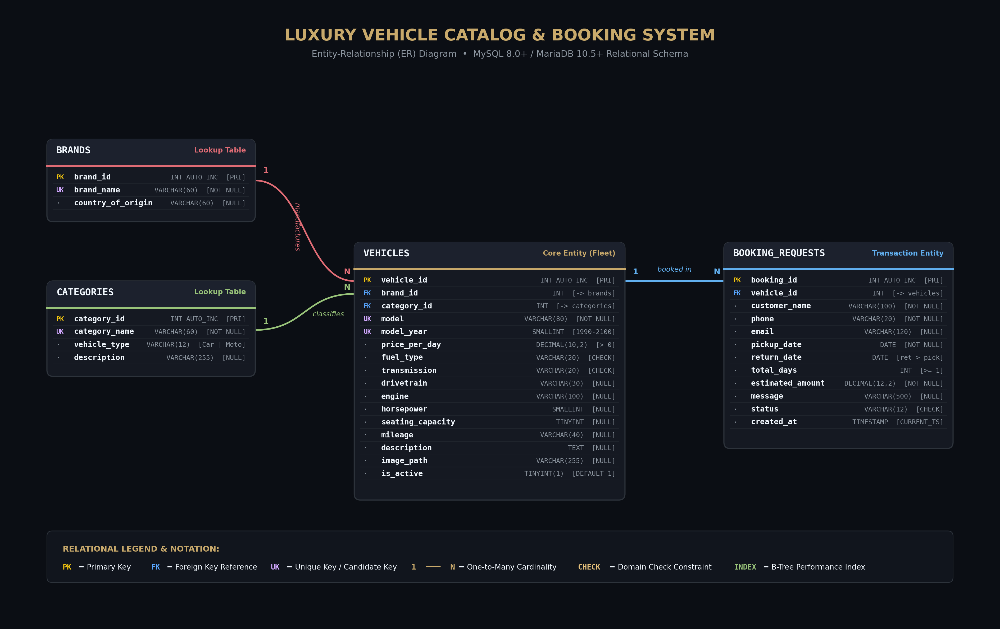
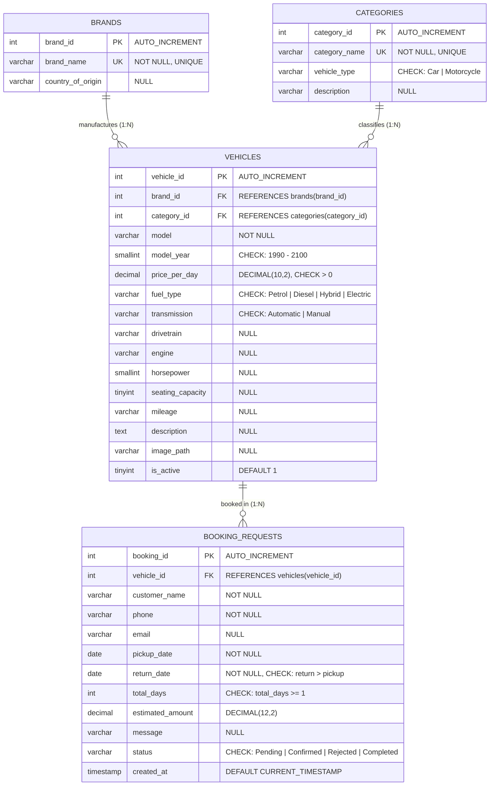

# Entity-Relationship (ER) Diagram

This document specifies the relational database model for the **Luxury Vehicle Catalog & Booking System**, audited and structured for MySQL 8.0+ and MariaDB 10.5+.

---

## 📊 Visual ER Diagram

---

## 📐 Mermaid Relational Specification

---

## 🗄️ Relational Model Breakdown

### 1. `brands` Table (Lookup)
- **Primary Key**: `brand_id` (`INT AUTO_INCREMENT`)
- **Unique Constraint**: `brand_name` (`VARCHAR(60) NOT NULL UNIQUE`)
- **Nullable Attribute**: `country_of_origin` (`VARCHAR(60) NULL`)
- **Relationship**: 1 Brand has $N$ Vehicles (`1 ───< N`)

### 2. `categories` Table (Lookup)
- **Primary Key**: `category_id` (`INT AUTO_INCREMENT`)
- **Unique Constraint**: `category_name` (`VARCHAR(60) NOT NULL UNIQUE`)
- **Domain Constraint**: `CHECK (vehicle_type IN ('Car', 'Motorcycle'))`
- **Nullable Attribute**: `description` (`VARCHAR(255) NULL`)
- **Relationship**: 1 Category classifies $N$ Vehicles (`1 ───< N`)

### 3. `vehicles` Table (Core Inventory Entity)
- **Primary Key**: `vehicle_id` (`INT AUTO_INCREMENT`)
- **Foreign Keys**:
  - `brand_id` $\rightarrow$ `brands(brand_id)` (`ON DELETE RESTRICT`)
  - `category_id` $\rightarrow$ `categories(category_id)` (`ON DELETE RESTRICT`)
- **Candidate Key (Unique)**: `UNIQUE (brand_id, model, model_year)`
- **Domain Constraints**:
  - `CHECK (price_per_day > 0)`
  - `CHECK (model_year BETWEEN 1990 AND 2100)`
  - `CHECK (fuel_type IN ('Petrol', 'Diesel', 'Hybrid', 'Electric'))`
  - `CHECK (transmission IN ('Automatic', 'Manual'))`
- **Performance Indexes**:
  - `idx_vehicles_brand` on `(brand_id)`
  - `idx_vehicles_category` on `(category_id)`
- **Relationship**: 1 Vehicle receives $N$ Booking Requests (`1 ───< N`)

### 4. `booking_requests` Table (Transaction Entity)
- **Primary Key**: `booking_id` (`INT AUTO_INCREMENT`)
- **Foreign Key**: `vehicle_id` $\rightarrow$ `vehicles(vehicle_id)` (`ON DELETE RESTRICT`)
- **Domain Constraints**:
  - `CHECK (return_date > pickup_date)` (Enforces checkout convention)
  - `CHECK (total_days >= 1)`
  - `CHECK (status IN ('Pending', 'Confirmed', 'Rejected', 'Completed'))`
- **Default Values**:
  - `status`: `'Pending'`
  - `created_at`: `CURRENT_TIMESTAMP`
- **Performance Indexes**:
  - `idx_bookings_status` on `(status)`
  - `idx_bookings_vehicle` on `(vehicle_id)`

---

## 🎓 Academic Viva Highlights
1. **Referential Integrity**: Child records cannot reference non-existent brands or categories; deletion of active parent records is prevented by foreign key constraints.
2. **Strict Monetary Precision**: Daily prices (`DECIMAL(10,2)`) and estimated totals (`DECIMAL(12,2)`) avoid IEEE 754 floating-point rounding inaccuracies.
3. **Index Strategy**: High-cardinality search filters and join predicates are indexed to optimize query execution plans (`EXPLAIN`).
